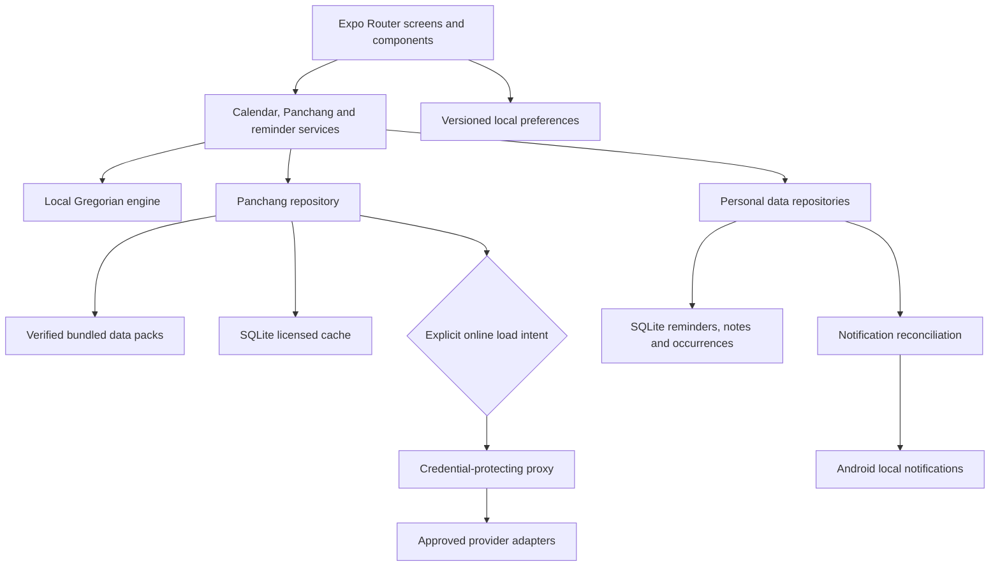

# Hindu Calendar — Codex Master Plan and Build Prompt

**Status: PLAN READY FOR REVIEW — IMPLEMENTATION NOT APPROVED**  
**Plan date:** 27 September 2026  
**Project:** `/home/pooniya/Documents/p_project/a_App/7.Panchag-calender`  
**Working product:** Hindu Calendar - Panchang  
**Platform:** Android application using React Native, Expo, and TypeScript

> This is the complete product and execution contract for the build. Read it fully before starting. The current task is planning only. Do not scaffold the app, install app dependencies, generate paid data, deploy infrastructure, or publish anything until the user explicitly says **yes, start** in this conversation.
>
> After approval, complete the agreed implementation, testing, fixes, documentation, and release preparation as one coordinated effort. Do not stop after a scaffold or ask for permission between routine phases. Preserve progress in files so work can resume accurately across sessions. External accounts, data licences, actual device access, purchases, deployments, and store review remain real dependencies; never report them as completed without evidence.

## Reading guide

- **Product and screens:** sections 1–7.
- **Architecture, calendar correctness, and data:** sections 8–15.
- **Reminders, privacy, and quality:** sections 16–21.
- **Execution, release, and completion:** sections 22–26.
- **Questions and approval:** section 27.
- **Current research and original-requirement coverage:** sections 28–29.

The original draft is preserved at `.codex/mahi-team/planning/source-master-prompt.md`. This revision consolidates its 109 numbered sections and resolves conflicting instructions. New technical choices are proposals until approval; religious conventions and provider permissions are never inferred from that approval.

---

## 1. Product outcome and fixed boundaries

Build a trustworthy, readable Hindu calendar that opens directly to a traditional-style month calendar. Users can browse dates, inspect Panchang, festivals, vrats and holidays, and manage personal reminders without an account.

### Required experience

1. Choose Hindi or English and a state/city without GPS.
2. Open the current month; see Gregorian dates and available, correctly labelled Hindu information immediately.
3. Switch between Month, Week and Today; remember the last selection.
4. Tap a date for Panchang, observances, holidays, reminders and notes.
5. Explicitly load detailed Panchang for the selected city when required.
6. Create, edit, search and delete local reminders with Gregorian recurrence and local notifications.
7. Browse offline using bundled and lawfully retained downloaded data.
8. Use larger text, Simple Mode, TalkBack and visible navigation buttons comfortably.

### Fixed product decisions

- Android first; no web app, iOS deliverable or web wrapper.
- React Native + Expo + strict TypeScript; Expo Router navigation.
- Exactly four tabs: **Home, Calendar, Reminders, More**.
- Hindi and English fully usable at first release.
- Saffron/Bhagwa, gold and cream visual identity; original artwork and layouts.
- No signup, login, advertising, analytics SDK, social feed, cloud profile or backend user database.
- Reminders and notes remain on the device; no Firebase or remote push service is required.
- Trusted source data for Panchang; no fabricated calculations, timings or festival dates.
- Rich bundled data target: **2026–2029 inclusive**, for explicitly declared locations and conventions.
- Ordinary Gregorian navigation remains independent of all Panchang services.
- A small serverless proxy is allowed when needed to protect provider credentials.
- Prepare a real Android preview build and production AAB, with evidence and remaining release steps.

### Outside the first release

Horoscopes, kundli, matchmaking, predictions, astrologer chat, subscriptions, commerce, AI chat, contacts import, GPS tracking, remote personal-data sync, widgets and social features.

Post-core options: daily Panchang sharing, printable month views, favourite festivals, device-calendar export, Android widget, additional themes and downloadable future-year packs. Implement only if separately selected; do not silently expand the core build.

## 2. Identity, defaults and product assumptions

| Setting | Planned value | Rule |
|---|---|---|
| App name | `Hindu Calendar - Panchang` | Working name; centralized configuration |
| Launcher name | `Hindu Calendar` | Confirm before store submission |
| Internal name / slug | `HinduCalendar` / `hindu-calendar-panchang` | Preserve consistently |
| Android application ID | `com.pooniya.hinducalendar` | Confirm ownership before first publication |
| Deep-link scheme | `hinducalendar` | Validate all incoming parameters |
| Version | `1.0.0`, versionCode `1` | Monotonically increase versionCode for later releases |
| Launch language | Hindi on Hindi devices, otherwise English | User can change immediately |
| Home / density | Month / Simple | Remember user preference |
| Theme | Bhagwa light | Dark mode deferred until separately polished |
| Week start | Sunday | Saturday/Monday-first layout rules must still be testable; expose Sunday/Monday preference |
| Numerals | Standard digits | Optional Devanagari digit setting |
| Panchang timezone | Selected city's IANA timezone | India normally `Asia/Kolkata`; never substitute device timezone |
| Reminder timezone | Explicit timezone saved at creation | Default selected city; display it in the form |
| Reference data selection | Broadest verified convention available | User delegated the choice; select and document the actual profile in Phase 1 |
| API/data spend | Free sources only | User confirmed; no paid source, licence, upgrade or overage fallback |
| Notification state | Off until enabled by user | Permission requested contextually |

Do not make the proposed reference city the user's selected city without telling them. Onboarding asks for their city; a reference pack is a separately labelled fallback.

## 3. Scope and coverage contract

| Area | Required implementation | Completion evidence |
|---|---|---|
| Gregorian calendar | Today/week/month, date detail, picker, exact-date search | Works offline across documented date range |
| Panchang | Five limbs, Hindu date, sun/moon, provenance, reference/local distinction | Schema fixtures plus live source verification |
| Advanced timing screens | Choghadiya, Hora, named Muhurta, astronomy | Verified supported fields; accurate unavailable states for unsupported fields |
| Festivals/vrats | Lists, details, regional variants and canonical IDs | Source references and coverage report |
| Holidays | National/state/UT layers and selection | Official year-specific sources where published |
| Personal tools | Reminders, birthdays, anniversaries, notes, occurrence completion | SQLite persistence and native scheduling tests |
| Accessibility | Simple Mode, four font sizes, TalkBack, readable Hindi | Device checks and screenshots |
| Languages | Complete Hindi and English | Translation key parity and reviewed core terminology |
| Release | Preview APK, AAB, listing drafts, privacy, licences | Build artifacts, checksums and QA report |

**Coverage is not inferred from an empty schema.** The target pack needs 1,461 distinct dates: 365 + 365 + 366 + 365. This count is **per reference location/convention**, not proof of coverage across all India.

- Full basic Panchang coverage for 2026–2029 remains required for the approved pack profile.
- Richer original festival descriptions and verified timing content prioritize 2026 through mid-2027; later years still require standard Panchang coverage.
- UI support for every Indian state/UT does not imply published government holiday data exists for every future year. Display coverage honestly.
- Missing credentials or redistribution rights leave the data milestone blocked. Continue independent software work, but do not call the complete app ready.
- Extra Indian languages have a defined preparation phase in section 7. Only reviewed, complete languages become selectable.
- Hindu recurrence is conditional on trustworthy observance data and explicit rule support, as described in section 16.

## 4. Navigation and onboarding

### Route map

```text
app/
  _layout.tsx
  onboarding.tsx
  (tabs)/
    _layout.tsx
    index.tsx                 # Home
    calendar.tsx              # Explorer
    reminders.tsx
    more.tsx
  date/[date].tsx
  search.tsx
  panchang/
    index.tsx
    choghadiya.tsx
    hora.tsx
    muhurta.tsx
    astronomy.tsx
  festivals/
    index.tsx
    [eventId].tsx
  holidays/index.tsx
  reminders/
    create.tsx
    [id]/index.tsx
    [id]/edit.tsx
  settings/
    index.tsx
    language.tsx
    location.tsx
    appearance.tsx
    calendar.tsx
    notifications.tsx
    storage.tsx
  about/
    privacy.tsx
    sources.tsx
    licenses.tsx
```

Use route parameters for an occurrence date/location when a festival has multiple occurrences. Validate deep links and reject malformed dates or unknown IDs without crashing. Android back returns to the previously selected month/date; opening a reminder notification resolves its saved ID after database initialization.

### Onboarding

1. Language: हिन्दी / English.
2. State and searchable city selection, explaining that timings use the chosen city and GPS is unnecessary.
3. Optional Simple/Detailed preview, then Home. Default Simple.

No notification prompt during onboarding. Persist completion only after required preferences save successfully. If city selection is deferred, allow Gregorian browsing and clearly show that local Panchang needs a city; do not silently use device location.

Tab labels: होम / कैलेंडर / रिमाइंडर / अधिक. Use recognizable Home, CalendarDays, Bell and Menu icons with text labels.

## 5. Screen-by-screen acceptance

| Screen | Content and actions | Required failure/edge behaviour |
|---|---|---|
| Home — Month | Gregorian month, Hindu month context, Samvat when sourced, arrows, Today, month/year picker; 7-column grid; compact monthly festivals | No network on month swipe; reference-city label when using reference data; multiple Hindu months shown as a range where relevant |
| Home — Today | Weekday/date, Hindu date, important vrat/festival, sourced sunrise/sunset and Rahu Kaal, today's reminders, upcoming items, full Panchang action | Each timing has correct location context; missing data never appears as zero or a sample |
| Home — Week | Seven dates with tithi, key event and reminder markers | Explicit range load for missing data; retain visible Gregorian dates |
| Calendar explorer | Fast month/year navigation, Today, date search, range loading | Supports documented broad Gregorian range offline; no endless swipe requirement |
| Date detail | Hindu date and five limbs, transition times, sun/moon, festivals, holidays, personal notes and reminders; **+ Add reminder** with selected date pre-filled | Immediate local content; pre-filled reminder date matches the viewed date; separate explicit local detail action; loading cannot erase notes or calendar |
| Full Panchang | Date/city selector, collapsible limbs, astronomy and timing groups | Show provenance and convention; unsupported section explained clearly |
| Choghadiya / Hora | Day/night segments, localized names and time ranges | Cross-midnight date labels; only provider-supported intervals |
| Muhurta | Verified named Abhijit, Brahma Muhurta, Amrit Kaal periods | No invented auspicious recommendations or marriage/housewarming calculator |
| Astronomy | Sunrise, sunset, moonrise, moonset, phase, signs when defined | Distinguish unavailable, unsupported and no event that day |
| Festival/vrat list | Month/year, category and regional filters, search | Multiple observance variants stay distinct |
| Festival detail | Date, related tithi, concise original significance, sourced timings, regional notes, add reminder | Puja/Parana shown only when verified; occurrence identity preserved |
| Holidays | National/state/regional entries with year/state filter | Holiday type and issuing authority; no-data differs from no holiday |
| Reminders | Upcoming/past/completed, search, categories, create/edit/delete, notification switch | Completion applies to one recurring occurrence; permission denial preserves reminder |
| Reminder form | Title, category, date, optional time, recurrence, notes, timezone, notification preference | Validation, recurrence preview, unsaved-change protection, no-time notification rule |
| More | Grouped Panchang, festivals/vrats, holidays, calendar settings, personalization and About | All entries navigate; no decorative dead-end menu items |
| Settings | Language, location, supported convention, home view, density, layers, font, Simple Mode, notifications, cache | Settings changes never silently fetch data or delete personal records |
| Storage / About | Cache size and clear action; sources, privacy, version, licences, support | Cache clearing leaves notes/reminders untouched; production contact must be real |

### Home layout outline

```text
[App title]                         [Search]
[Selected city] [Reference/local data context]
[Hindu month context • sourced Samvat]
[‹]       September 2026 [picker]       [›]
[Today]                  [Today | Week | Month]
[Sun Mon Tue Wed Thu Fri Sat]
[Six or fewer rows of dates with readable markers]
[Selected-day summary / View day]
[This month's festivals and vrats]
[Home] [Calendar] [Reminders] [More]
```

The Gregorian month owns the grid. A Hindu month title does not turn this into a different lunar-month grid. If two lunar months or Samvat years occur in the displayed range, show both where known.

## 6. Design system and accessibility

Build reusable `AppText`, `Button`, `IconButton`, `Card`, `Chip`, `SectionHeader`, `Divider`, sheets/dialogs and empty/error/loading states. Feature components include CalendarHeader, MonthGrid, CalendarDayCell, WeekStrip, TodayCard, MonthYearPicker, PanchangSection, TimeRangeRow, SourceBadge, ReminderCard and RecurrencePicker.

- Semantic tokens for primary saffron, golden accent, cream surface, ivory cards, muted borders, dark body text, warm red Sunday and status colors.
- Starting palette proposal: primary `#A83E0C`, accent `#E8B44A`, background `#FFF8EC`, surface `#FFFFFF`, text `#2B2118`, muted text `#6A5948`, Sunday `#A52D2D`. Check every actual text/background combination before use.
- Minimum general control target: 48 × 48 dp. Seven date columns cannot always fit 48 dp widths on narrow phones: use full cell hit regions, generous row heights and an equivalent accessible day list; never shrink Hindi text to solve this.
- Aim for at least 4.5:1 contrast for normal text and 3:1 for large text and essential control boundaries.
- Simple density: date, concise tithi, one priority observance marker, reminder indicator. Detailed adds compact nakshatra/context when space allows.
- Today and selected date have distinct shapes/labels, not color alone. A count or “more” indicator handles overflowing events.
- App font sizes: Small, Default, Large, Extra Large; honor system scaling. At high scaling, use an agenda/day-list layout where a readable grid is impossible.
- Simple Mode increases text and controls and collapses advanced sections; it preserves the user's chosen Home view. A visible Today shortcut supports the large Today-card experience.
- Hindi matras must not clip; validate line height, button widths and multiline labels. Bundle a licensed Devanagari font only if system rendering is inadequate; keep its licence.
- TalkBack labels include date, selection/today state, tithi and relevant event count. Define focus order, selected state and modal focus return.
- Visible arrows and buttons supplement gestures. Keyboard must not cover reminder fields. Support Android back, safe areas and edge-to-edge insets.
- Motion is subtle, approximately 150–250 ms, respects reduced-motion preferences and never blocks navigation.
- No decorative spinning religious symbols or copied calendar artwork. Prepare original placeholder Om/calendar branding and `BRANDING_REPLACE.md`.

## 7. Localization and search

Use i18next, react-i18next and expo-localization with canonical domain IDs and translation resources. Do not put user-facing strings directly in components. Format dates and numbers at the presentation boundary.

- Complete English and Hindi labels, errors, permissions explanations, accessibility labels, empty states and notification text.
- Keep Sanskrit/Hindi calendar terms in reviewed mappings; provider language codes may differ from app locale codes.
- Support standard and Devanagari digit input for date/year search; validate and normalize before parsing.
- Local search covers date, month/year, festival/vrat/holiday aliases and queries such as `Diwali 2027`, `दिवाली 2027`, `Ekadashi`.
- No API requests per keystroke. Debounce local searches and return explicit coverage messages.
- Preserve user-entered notes/titles as entered; do not translate them.
- Stage 2 resources: Gujarati, Marathi, Bengali, Tamil, Telugu, Kannada, Malayalam, Punjabi, Odia and Assamese; Sanskrit is optional later.
- After Hindi/English quality gates, prepare resource files, term glossaries and a review-status manifest for Stage 2. Draft translations remain internal until complete and reviewed. Do not advertise unreviewed languages in the store listing.
- Language changes update screen content immediately and reconcile the text of future scheduled notifications without creating duplicates.

## 8. Technical architecture and version policy

### Planned stack

| Concern | Decision |
|---|---|
| Runtime | Current stable Expo SDK and its compatible React Native/React versions |
| Baseline researched | Expo SDK 57, React Native 0.86, React 19.2.3; recheck on build start |
| Toolchain | Compatible Node LTS; SDK 57 docs list minimum Node 22.13.x; npm lockfile |
| Navigation | Expo Router with four tabs and nested stack routes |
| Styling | Small typed React Native design-system layer by default; NativeWind only if compatibility and maintenance benefits are demonstrated |
| Transient state | Zustand for UI state/preferences hydration; SQLite remains persistent domain authority |
| Preferences | AsyncStorage for simple settings; one versioned settings repository |
| Structured storage | expo-sqlite with SQL migrations and parameterized queries |
| Notifications | expo-notifications, using a development build for native verification |
| Localization | i18next, react-i18next, expo-localization |
| Calendar utilities | date-fns and a compatible timezone utility where needed; Gregorian operations only |
| Runtime validation | Zod for imports, provider responses, data packs and proxy requests |
| Icons | lucide-react-native with compatible react-native-svg |
| Tests | jest-expo, React Native Testing Library, meaningful domain/integration tests; Android E2E using a verified compatible runner such as Maestro |
| Quality | TypeScript strict, ESLint, Prettier, Expo Doctor, dependency/license review |
| Builds | Local Android build where tooling permits; EAS development/preview/production profiles |
| Secret-bearing API access | Conditional Cloudflare Worker or similarly small serverless proxy |

The baseline comes from [Expo's current SDK table](https://docs.expo.dev/versions/latest/) and [SDK 57 release notes](https://expo.dev/changelog/sdk-57), checked 27 September 2026. Select a stable patched release and record exact versions in `docs/RESEARCH.md`; do not independently upgrade React Native beyond Expo compatibility. Verify minimum Android version from the chosen SDK and final native dependencies, then record `minSdkVersion`, compile and target SDK explicitly.

Use `npx expo install` for Expo-managed compatibility. Pin reproducibility through the lockfile and Node version file. Check current library docs before each unfamiliar integration; never copy an API from an unverified main-branch snippet into a stable SDK implementation.

### Dependency boundaries



UI code never parses provider responses or schedules native notifications directly. The Gregorian engine never imports an API client. Personal repositories never send content to the proxy. Import shared schemas into generator/proxy/client without pulling secret-bearing server modules into the mobile bundle.

### Proposed source layout

```text
src/
  components/{ui,calendar,panchang,reminders,festivals}/
  features/{calendar,panchang,festivals,holidays,reminders,settings,search}/
  domain/{calendar,panchang,events,recurrence}/
  services/{panchang,notifications,storage}/
  db/{migrations,repositories}/
  data/{bundled,holidays,cities}/
  i18n/{locales,terms}/
  theme/
  store/
  config/
  types/
  utils/
shared/                         # Pure types, schemas and canonical IDs
scripts/
  generate-panchang-data/
  validate-panchang-data/
  generate-holiday-data/
serverless/panchang-proxy/       # Only if runtime provider secrets require it
assets/{branding,fonts}/
tests/{unit,integration,fixtures,e2e}/
docs/
play-store/
.codex/mahi-team/                # Build progress, decisions, QA evidence
```

## 9. Gregorian dates, timezones and calendar conventions

### Gregorian contract

- Initial documented browsing range: **0001–9999 CE**, proleptic Gregorian calendar. This is the finite implementation of the original “arbitrary years” request; no dependence on bundled years. BCE support is outside this release.
- Dates are validated civil `YYYY-MM-DD` values, never silently interpreted as UTC-midnight instants.
- Support leap-century rules, year boundaries, variable month lengths and selected week start. Handle JavaScript's special treatment of numeric years 0–99 explicitly.
- Generate only requested months, using deterministic 4–6-row grids or a consistent six-row layout selected during UI implementation. Adjacent-month dates have clear styling.
- Date arithmetic operates on calendar days, not fixed 24-hour durations.
- Recompute Today on resume and when the relevant timezone/date changes. Do not leave yesterday highlighted after midnight.
- Gregorian browsing bounds, native alarm scheduling bounds and each provider's date bounds are separate capabilities. Reject unsupported online requests locally.

### Computation profile

Every Panchang record has a stable semantic profile ID derived from:

- Canonical app location ID, latitude/longitude and IANA timezone.
- Month system: Amanta, Purnimanta or another explicitly supported system.
- Observance tradition/rule set, separately from month naming.
- Ayanamsa and sunrise/observation convention when relevant and supplied.

Provider identity, calculation/engine version and normalization schema version belong in provenance and versioned cache fields, not in this semantic profile ID. Keep explicit, independently verified compatibility mappings between each provider/engine configuration and the profile it can satisfy. A newer source/schema version can replace older compatible records after validation; an unverified convention change creates a different profile rather than being silently treated as equivalent.

Purnimanta alone does not define Ekadashi or festival observance rules. Do not translate one tradition into another by renaming a month. Preserve adhika/kshaya month indicators when the source supplies them.

### Reference data versus local data

Even a basic tithi label selected at sunrise and a festival's assigned civil date can depend on location and convention. Do not classify all “basic” data as location-independent.

1. Prefer matching location/convention data when available.
2. A different reference pack can be shown only as an explicitly labelled reference calendar.
3. Keep exact local timings out of an unlabeled reference overlay. On detail pages, group reference and selected-city values separately if both are shown.
4. Changing city or convention changes the lookup profile immediately; it does not silently rewrite old cached records.
5. Do not round unrelated cities into one cache key. Use stable city/profile IDs and the coordinates actually sent.
6. Samvat values come from verified data/rules, not a universal Gregorian-year offset.

## 10. Panchang and event domain contracts

Use canonical enum IDs with local translations. Validate external payloads at runtime. This is a contract sketch; refine it from real, documented provider responses before implementation.

```ts
type CivilDate = string;       // Validated YYYY-MM-DD
type Instant = string;         // Full ISO timestamp with offset or UTC Z
type Availability =
  | "available" | "not_loaded" | "not_supported" | "no_event"
  | "outside_coverage" | "expired" | "invalid";

interface Period {
  id: string;
  startsAt: Instant | null;    // Null means genuinely unknown
  endsAt: Instant | null;
}

interface Provenance {
  providerId: string;
  profileId: string;
  sourceVersion: string | null;
  schemaVersion: number;
  retrievedAt: Instant;
  licencePolicyId: string;
  validUntil: Instant | null;  // Retention/display policy, not astronomical age
}

interface PanchangDay {
  date: CivilDate;
  timezone: string;
  provenance: Provenance;
  summaryAtSunrise: {
    tithiId: string | null;
    pakshaId: "SHUKLA" | "KRISHNA" | null;
    masaId: string | null;
    monthSystem: string;
    isAdhika: boolean | null;
    isKshaya: boolean | null;
    vikramSamvat: number | null;
    shakaSamvat: number | null;
  };
  limbs: {
    varaId: string;
    tithi: Period[];
    nakshatra: Period[];
    yoga: Period[];
    karana: Period[];
  };
  astronomy: Record<string, {
    status: Availability;
    instant?: Instant;
    canonicalValue?: string;
  }>;
  namedPeriods: Record<string, Period[]>;
  observanceOccurrenceIds: string[];
  fieldAvailability: Record<string, Availability>;
}
```

Implementation must narrow the open `Record` keys into supported typed field IDs. Absence is not a zero-value time or an empty-string success. Civil display date and calculation sampling instant must be explicit; a provider's noon snapshot cannot be relabelled “at sunrise.”

### Transition and observance rules

- Preserve all tithi/nakshatra/yoga/karana intervals intersecting the source day window, not just one end time.
- Allow multiple transitions, repeated/absent tithis at sunrise and periods starting on the previous date.
- Store full instants so “after midnight” is displayed with the next date or a clear `+1 day` label.
- Do not turn unknown moonrise into `00:00`; distinguish no moonrise on that civil day from missing source data.
- Preserve the source precision; do not append invented seconds.
- Ekadashi fast date and Parana are separate sourced fields. Apply the same discipline to Janmashtami, Shivaratri, Diwali, Pradosh and Sankashti.
- Canonical festival type ID and occurrence ID are different. One festival can have multiple years, regions, traditions and dates.
- A festival occurrence includes date, optional ending date, profile/region, category, tithi relationship, verification state, sources and optional sourced timing intervals.
- Store original concise content separately from computed timing records; preserve attribution and content licence metadata.

## 11. Provider choice, licences and data rights

### Current assessment — 27 September 2026

| Candidate | Verified planning evidence | Decision for this plan |
|---|---|---|
| Navamsha | Developer hub documents Panchang APIs and secret-key authentication; pricing advertises a launch allowance | First external API candidate to evaluate, conditional on free access, response validation and rights |
| Prokerala | Published terms constrain storage; ordinary cache refresh requirement is 24 hours unless a documented exception applies | No default permanent bundling; comparison/online use only under compatible terms |
| AstrologyAPI / Vedic Rishi | Official reference documents basic and advanced Panchang endpoint families | Third candidate; cost, convention, cache and redistribution rights remain to verify |
| Open-source engine/data | No implementation has yet passed this project's licence and accuracy review | Priority feasibility track for free offline packs; no invented engine or automatic substitution |

Sources: [Navamsha developer hub](https://www.navamsha.in/developers), [Navamsha pricing](https://www.navamsha.in/pricing), [Navamsha terms](https://www.navamsha.in/legal/terms), [Prokerala terms](https://api.prokerala.com/tos), [AstrologyAPI Panchang reference](https://astrologyapi.com/developers/v1/vedic/basic_panchang).

Navamsha's inspected public terms do not establish a clear perpetual offline redistribution grant. Treat that right as **unverified**, not denied or approved. Prokerala's standard storage restrictions conflict with the permanent pack design. These are architectural assessments of the inspected terms; a provider's applicable written agreement can change the outcome.

### Required provider comparison before activation

For each source, record endpoint URLs/version, auth, request/response schema, date limits, city/timezone inputs, supported traditions, Hindi/canonical terms, returned fields, accuracy comparisons, per-endpoint credits, rate limits, availability, attribution, commercial usage, allowed cache age, bulk generation rights, offline redistribution rights and termination/deletion obligations.

Licence approval states: `unverified`, `approved_for_runtime`, `approved_for_cache`, `approved_for_bundling`, `restricted`. Store evidence URL or private agreement reference and review date. Never place confidential agreements or credentials in a public repository.

A free tier is not a permanent price or a redistribution licence. Use a budget worksheet rather than a promise of zero operating cost:

```text
Pack work = 1,461 days × approved profiles × endpoints per day
            + bounded retries + comparison samples
Runtime work = uncached explicit user loads × endpoint credit cost
Operating cost = provider plan/overage + proxy hosting + build service
```

For example, six full city profiles with one daily endpoint require 8,766 base requests before retries. Credits may differ from request counts. Estimate from the actual plan before bulk generation and enforce the free allowance. Purchases, automatic upgrades and paid overage are outside the user's chosen scope.

If no permitted free source can supply the full pack, record a release blocker with options: obtain explicit no-cost rights, select a suitably licensed verified engine/dataset, or ask for a documented change to offline coverage. Do not silently replace the requested pack with online-only access or ask repeatedly to relax the free-only choice.

### Free-source feasibility order

1. Evaluate permissively licensed Panchang engines/datasets for offline generation, beginning with the candidate in section 28. Inspect source, dependencies, bundled reference data, published rules, maintenance and independent comparisons; an MIT badge or README accuracy claim is insufficient.
2. Evaluate Navamsha's free API for validation and optional online detail. Bundling requires explicit usable rights; free call availability alone is insufficient.
3. Evaluate other no-cost sources only if their capabilities and rights improve verified coverage. Keep Prokerala/AstrologyAPI as documented candidates, not assumed production fallbacks.
4. Astronomy Engine may support factual astronomy, but it cannot replace an observance rules engine by itself. Do not construct unreviewed religious rules around astronomical primitives.
5. Check transitive licences. Swiss Ephemeris-based wrappers require specific licence review; do not introduce paid licensing or assume the user has agreed to publish this app under a copyleft licence.

If a vetted local engine is selected, record the architecture decision and implement it behind the same domain boundary. Generator outputs still need complete validation and provenance. Prefer build-time pack generation first; use runtime computation only after Android performance and domain correctness are verified. Unsupported online-only fields remain explicit limitations.

## 12. Repository, cache, network and fallback policy

### Separate reads from online actions

- `readDay` / `readRange`: local only; return available records and a coverage result.
- `loadDay` / `loadRange`: require an explicit user load intent, supported profile and date range; fetch only missing or policy-expired records.
- `refreshDetails`: explicit refresh action, bounded by source policy.
- Provider adapters expose capabilities before selection; do not instantiate speculative adapters solely to fill three filenames.

### Compatible-data lookup order

First filter by schema support, permitted retention/display period and matching computation profile. Then choose the newest verified correction version from an applicable pack or cache, using deterministic source preference where versions are equivalent.

1. Matching bundled or downloaded pack / matching valid cache.
2. If no match, labelled reference pack, where the user can distinguish its scope.
3. Explicit online request through enabled compatible providers.
4. Honest unavailable result with the Gregorian and personal layers intact.

A newer correction must not remain hidden behind an older bundle. A different-city bundle must not override matching local data. Keep one coherent provider result for calculation fields; independently sourced holiday/personal layers may be combined with their own provenance.

### Fetch policy

- No provider requests on launch, ordinary swipes, search typing, opening settings/reminders, font changes or density changes.
- Day loads cover one date; week loads seven; month loads only the requested month dates.
- The original previous-10/today/next-30 window becomes an **optional explicit “Download nearby 41 days” action**. It is never automatic onboarding or startup work.
- Before a range load, show requested and missing dates. Track completed/failed/remaining counts and allow cancellation.
- Start with concurrency 2, or lower if provider limits require it; maximum two retries for eligible transient failures; exponential backoff with jitter; honor `Retry-After`.
- Proposed request timeout: 15 seconds. Bound total foreground retry time and offer retry rather than holding a screen indefinitely.
- Deduplicate concurrent requests by profile/date/detail level. Coalesce equivalent in-flight work.
- Persist successful dates individually; retry only failed dates. Cancellation stops new requests and safely discards late responses from superseded screen/profile requests.
- No network background task unless separately designed and authorized. Progress is durable and can resume explicitly.

### Fallback and errors

Categories: offline/network, timeout, unauthorized configuration, quota, rate limit, unsupported date/profile, malformed response and service unavailable.

Use at most the configured compatible provider chain, once per bounded operation. Skip providers without keys, rights or required capabilities. Do not use fallback to evade quota restrictions. Auth failures surface a configuration problem; they do not cause endless retries. Rate-limit/cost exhaustion can stop the request and show retry later. Never mix a successful tithi from one convention with sunrise or observance rules from an incompatible convention.

### Retention and invalidation

Cache keys include date, profile, detail level, provider and schema/data version. Track fetched time, permitted expiry, correction version and policy ID. Mathematical immutability does not override contractual expiry. Expired records are not displayed when terms require refresh; unavailable offline is an honest outcome for that source. An app with expired online data still uses eligible bundled data and local tools.

Clearing cache removes only downloaded provider records/files. It never deletes reminders, notes, settings or bundled assets.

## 13. Data generation, packaging and accuracy gates

### Generator workflow

1. Read an approved source/licence policy and server-only credentials where an API is used; a vetted local engine needs no API key.
2. Validate year range and fully specified reference profile.
3. Produce a dry-run request/credit estimate; enforce the approved budget.
4. Fetch or generate a small sample and validate field semantics, especially sunrise versus supplied-clock-time snapshots.
5. Generate permitted records with checkpoints and resume support; API work also uses bounded retries and throttling.
6. Normalize into canonical IDs and full instants; reject unknown/invalid shapes.
7. Write versioned month packs through a temporary output, then validate before activation.
8. Generate coverage, discrepancy and attribution reports; fail the production gate on missing required records.

Use test fixtures only under `tests/fixtures/`; label synthetic fixtures unmistakably. Never package them as religious data. Retain real response fixtures only where source terms permit storage and redact credentials.

### Pack layout and manifest

```text
src/data/bundled/panchang/
  manifest.json
  <profile-id>/
    2026/01.json ... 12.json
    2027/01.json ... 12.json
    2028/01.json ... 12.json
    2029/01.json ... 12.json
```

Manifest fields: pack ID/version, schema version, profile, source/provider/engine version, terms or permission reference, attribution, generator version, generation time, date coverage, record count, per-file byte size and checksum, field coverage, correction version and review status.

Do not parse four years of data at every launch. Measure packaged-data loading in release mode: Metro imports may still bundle/evaluate JSON eagerly. Use an asset manifest with runtime file reads or a packaged read-only SQLite dataset if that is simpler and faster; keep generator month outputs auditable.

### Validation

- Exactly 1,461 unique dates per approved complete profile; correct leap day and month boundaries.
- Required five-limb/Hindu-date fields and explicit optional-field availability.
- Valid canonical IDs, timezone/profile metadata, parseable instants and valid interval order.
- Correct handling of day-boundary overlaps, missing events and legitimate tithi discontinuities.
- No undocumented coercion of provider names to canonical IDs; unknown mappings fail validation.
- Every religious occurrence has provenance, region/convention and a distinct occurrence ID.
- Required rights, attribution, checksums and correction versions are present.
- Cross-source samples cover Diwali, Holi, Janmashtami, Maha Shivaratri, Ekadashi/Parana, Purnima/Amavasya, Navratri boundaries, Raksha Bandhan, Dussehra and Makar Sankranti across Jodhpur, Jaipur, Delhi, Mumbai, Kolkata and Chennai where comparable data is available.
- Compare like-for-like profiles and record source precision and legitimate convention differences. Any unexplained day assignment or material time discrepancy blocks that record's approval; do not invent a universal tolerance to make tests pass.

The comparison report identifies reviewed dates, fields, sources, mismatches and resolution. Provider marketing claims and agreement between two samples are not proof of complete accuracy.

### Future data updates

For first release, deliver versioned bundles and an importer interface/documentation for future packs. Downloadable packs remain optional. If implemented, use HTTPS plus a trusted signed manifest, pinned verification key, hashes, schema/size limits, atomic activation and rollback. A checksum alone does not authenticate the publisher. Load data only, never remote executable code.

## 14. Cities, festivals and government holidays

### City dataset

Bundle a lightweight, licensed India city list with stable IDs, localized names/aliases, state/UT IDs, latitude, longitude, IANA timezone and source/version metadata. Cover all states/UTs and practical major-city selection; expand to district towns where the dataset is trustworthy and small enough. Include Jodhpur, Jaipur, Delhi, Mumbai, Kolkata and Chennai for QA.

Search locally and normalize aliases without losing the original name. Do not scrape a proprietary geocoder. No GPS permission is required. If an area is absent, explain the available city selection; do not silently map it to a distant city.

### Festival layer

Include major festivals and verified recurring observances: Ekadashi, Purnima, Amavasya, Pradosh, Sankashti Chaturthi, Masik Shivratri, Navratri and other supported categories. Canonical names include Diwali, Holi, Janmashtami, Maha Shivaratri, Ram Navami, Hanuman Jayanti, Ganesh Chaturthi, Raksha Bandhan, Dussehra, Makar Sankranti, Akshaya Tritiya and Karwa Chauth.

Festival details may include original short significance/observance notes, but no copied articles or invented rituals/timings. Preserve regional names and alternative dates with their profile. “No festival recorded” means the dataset has no matching entry, not that no community observes anything that day.

### Holiday layer

Keep religious observances separate from government declarations. Records include:

- Stable occurrence ID, name ID and Gregorian date(s).
- Country/state/UT/local jurisdiction.
- Type: national public, state gazetted, restricted/optional, bank, or local.
- Official source URL, issuing authority, notification date/identifier and applicable year.
- Declared/observed date, revision and verification/publication status.

Use central and state government notifications for the relevant year. A festival is not automatically a public or bank holiday. Unpublished future calendars remain `not_yet_published`; do not project a previous year's state list forward.

Provide a year × jurisdiction coverage matrix and a correction/import workflow. Date views combine Gregorian, Panchang, festival, government-holiday, reminder and note layers without merging their meanings.

## 15. Local database and migrations

| Table / store | Important fields | Invariants |
|---|---|---|
| `reminders` | UUID, title, notes, category, start civil date, optional wall time, timezone, recurrence JSON/version, notification preference, revision, timestamps | Domain record survives notification failure |
| `reminder_occurrences` | Reminder ID, stable occurrence key, original scheduled date/time, completion/skipped state, timestamps | Unique reminder + occurrence key; completion does not end series |
| `notification_schedules` | Reminder/occurrence or repeat-trigger key, desired fingerprint, native ID, scheduled instant, status/error, revision | Multiple native IDs supported; retries are idempotent |
| `date_notes` | UUID, civil date, text, timestamps | User text never enters provider requests |
| `panchang_cache` | Composite lookup key, profile/date/detail/provider, schema/data version, payload, fetched/expiry time, policy ID | Invalid or disallowed payload never treated as usable |
| `data_pack_registry` | Pack ID/version, profile, coverage, manifest/hash, activation state | Only validated packs become active |
| `data_jobs` | Operation ID, requested profile/range, completed/failed dates, status | Resumable explicit downloads/generation metadata as appropriate |
| Preferences store | Schema version, language, city/state, view/density, font, layer flags, convention | One authoritative versioned preference model |

Canonical festival/holiday definitions can remain indexed pack data. Add SQLite indexes for reminder dates/categories, occurrence keys and Panchang profile/date/detail lookups. Avoid duplicating writable reminders in Zustand as a second source of truth.

- Migrations are numbered, transactional where supported and tested from prior schema fixtures.
- Enable foreign-key constraints and use parameterized SQL for all user input.
- Save reminder changes and desired scheduling state in a transaction; native notification operations occur afterward and are reconciled.
- Failed migration/import must not reset or erase personal data automatically. Preserve the prior database and expose a recoverable error path.
- Cache corruption can be discarded independently; user databases require careful recovery.
- Destructive personal-data deletion needs a clearly named user action and confirmation; “Clear cache” is never that action.
- Uninstall/clear-app-data removes local records. Explain this under Storage/Privacy. Manual user-controlled export/import is a later feature unless requested.

## 16. Reminder behaviour and recurrence

### Form and categories

Required title with proposed maximum 120 characters; optional note up to 5,000 characters; valid date, optional time, category, repeat rule and notification preference. Categories: Birthday, Anniversary, Religious, Medicine, Personal, Work and Other, fully localized. Preserve whitespace intentionally while rejecting blank titles.

An untimed entry is an all-day reminder with no alert by default. Turning on its notification prompts for an alert time, suggested 09:00 in the saved timezone. Show the choice before saving; do not silently choose midnight. Past dates can be saved as history; do not fire an immediate surprise notification.

### Gregorian recurrence contract

| Rule | Planned semantics |
|---|---|
| None | One occurrence on the saved date/time |
| Daily | Same wall time each calendar day |
| Weekly | Same weekday and wall time |
| Monthly | Same day number; skip months without that day, stated in preview |
| Yearly | Same month/day; February 29 skips non-leap years, stated in preview |
| End | No end by default; support an explicit end date |

Store the original anchor, rule version, interval and timezone. Never implement a month as 30 days or a year as 365 days. Show the next few occurrences before saving so month-end/leap-day rules are visible.

- Reminder timezone is fixed to the saved zone in v1. Device travel and Panchang city changes do not silently move existing reminders. The timezone remains editable.
- Define DST gaps as the next valid local time and overlaps as the earlier occurrence; record and test this policy even though India normally has no DST.
- Completing/skipping one occurrence leaves subsequent occurrences active. List past uncompleted occurrences as past, not falsely completed.
- Editing changes the series' future occurrences; completed history retains its original occurrence identity. Editing only one occurrence is deferred unless deliberately added with exception support.
- Deleting a series cancels every scheduled native ID and removes its occurrence records through the intended data action.
- Notification on/off and category preferences affect delivery, not the existence of reminders.
- Use finite-range recurrence expansion for lists/search; never expand an unbounded series into an infinite stored list.

### Hindu recurrence

Model optional rules for every verified Ekadashi, Purnima or Amavasya and yearly selected Hindu tithi. Activate only where an approved source supplies the applicable observance rules and sufficient future coverage.

Store profile, month system, masa, paksha, tithi, observance rule and adhika/absent/repeated-tithi policies. These policies must come from a verified rule set; Gregorian recurrence defaults do not apply. Display the verified scheduling horizon. Stop at coverage end with a clear status. Do not guess future observances or turn raw tithi equality into fasting dates.

## 17. Android notification delivery and reconciliation

Notifications are local. Do not register an Expo push token, add FCM credentials or upload personal reminder text.

### Native proof before promising delivery

During the notification phase, verify the selected stable Expo SDK's actual Android trigger support for daily, weekly, monthly and yearly rules, reboot handling, timezone behaviour and denied permissions. Test in a development/release build. Do not assume Expo Go behaviour proves release behaviour.

Use native repeat triggers only when they match the recurrence semantics. Otherwise use a bounded set of scheduled occurrences with an explicit horizon and replenishment policy; require a documented native/background solution if the promised recurrence needs continuation without reopening. A finite 30-day schedule is not an indefinite reminder implementation.

### Scheduling state machine

```text
User saves reminder
  -> SQLite transaction saves reminder + desired schedule revision
  -> scheduler checks channel, notification permission and alarm capability
  -> reconcile desired state against native scheduled requests
  -> cancel obsolete IDs and create missing schedules
  -> persist native IDs/status, or retain retryable failure state
```

Run reconciliation on startup/resume, create/edit/delete, notification setting changes, locale changes and relevant OS permission/timezone changes. Use deterministic identifiers/fingerprints and request revisions; rapid edits must not leave orphan alarms. Test crash recovery between database save and native scheduling.

### Permission and delivery policy

Create the appropriate Android notification channel before contextual permission flow. Distinguish saved, scheduled, permission denied, channel disabled and scheduling failed states.

Exact alarms have separate Android requirements. Evaluate `SCHEDULE_EXACT_ALARM` with user-granted access versus eligibility for `USE_EXACT_ALARM`, using the actual app function and current Play policy. No unconditional exact-delivery guarantee. If access is denied, provide supported best-effort scheduling or an explicit unscheduled state without crashing. [Android exact-alarm guidance](https://developer.android.com/about/versions/14/changes/schedule-exact-alarms)

Check reboot restoration, force-stop, battery restrictions, app update, clock change and long inactivity. Force-stop can prevent delivery until the user launches the app; expose practical troubleshooting without requesting unrelated permissions. Do not describe the Medicine category as a safety-critical medical alarm.

**Release evidence:** create and receive an alert on Android, edit it without duplicate delivery, delete it without later delivery, test recurring behaviour and permission denial, and record device/OS/build/version. Unit mocks alone do not satisfy this gate.

## 18. Proxy security, environment and free-service limits

Only create the proxy if the chosen runtime source needs secret credentials. Keep provider code for generation on the developer/server side. Navamsha explicitly treats API keys as secrets unsuitable for mobile client code. [Navamsha terms](https://www.navamsha.in/legal/terms)

### Minimal proxy contract

```text
POST /v1/panchang/day
  { date, cityId, profileId, detailLevel }

Success:
  { data, provenance, capabilities, cachePolicy }

Failure:
  { error: { code, retryable, retryAfterSeconds? }, requestId }
```

Use an allowlist of city/profile IDs and supported dates; derive coordinates server-side. Add a bounded range endpoint only if it materially reduces overhead and preserves request budgeting. Reject arbitrary provider URLs, unknown endpoints, oversized bodies and invalid inputs. Return safe errors without upstream headers, tokens or account details.

- HTTPS only in production; bounded timeout, output size and concurrency.
- Enforce per-client/IP limits and an aggregate provider quota/spend cutoff across instances.
- In-memory counters are insufficient for a globally deployed worker. Use an available edge enforcement primitive; any necessary minimal counter state contains no reminder/user profile database and must stay within the approved architecture.
- A shared key bundled in the app and CORS restrictions are not authentication for an Android client.
- Never forward notes, titles, birthdays or recurrence data to the provider.
- Disable or minimize request-body logging; document platform/IP log retention accurately.
- Provider allowlist, circuit breaker and quota cutoff fail closed to paid/overage traffic.
- Avoid free hosting plans that can bill overage automatically; offline features remain available when the free quota ends.
- Deployment stays pending explicit deployment authorization; source and setup documentation are part of the approved local build.

### Environment split

```text
# Mobile: safe public configuration only
EXPO_PUBLIC_PANCHANG_PROXY_URL=
EXPO_PUBLIC_ONLINE_PANCHANG_ENABLED=false

# Generator/proxy environment only; never imported by mobile code
PANCHANG_PROVIDER_PRIMARY=
NAVAMSHA_API_KEY=
PROKERALA_CLIENT_ID=
PROKERALA_CLIENT_SECRET=
THIRD_PROVIDER_API_KEY=
PANCHANG_ALLOWED_PROFILE_IDS=
PANCHANG_REQUEST_BUDGET=
```

Create separate `.env.example` files for mobile and proxy/generator. Secret values live in ignored local files or hosting secrets. Never ask for keys/passwords in chat or write them into docs. An empty mobile environment must launch and run all local features with honest online-unavailable messaging.

## 19. Privacy, permissions and content ownership

### Actual data flow

- Notes, reminders and event titles: local SQLite only.
- Preferences: local storage.
- Online Panchang: chosen date, source profile/city coordinates and required timezone pass through the proxy/provider; networking also exposes transport metadata such as IP to relevant operators.
- No analytics, advertisements or cloud user accounts.

Configure Android backup/data-extraction rules to exclude private records and restricted provider caches from cloud backup and supported device-transfer paths; verify the generated manifest/rules and document remaining OS/OEM limitations. Android Auto Backup otherwise includes app data by default. [Android backup documentation](https://developer.android.com/identity/data/autobackup)

Document app sandbox storage accurately; do not claim application-level database encryption unless it is actually implemented. Notifications may reveal reminder titles on a lock screen: choose appropriate private visibility and offer generic alert text where supported.

### Permission audit

Expected network and notification-related capabilities only as justified by the final build: Internet, notification permission, boot restoration and any intentionally selected alarm capability. Audit merged release manifests, including transitive packages.

No contacts, SMS, phone, microphone, camera, GPS, broad storage or calendar access for the core app. Do not add device-calendar permissions for a future optional export feature now.

### Content and privacy deliverables

Create `PRIVACY_POLICY.md`, `docs/DATA_FLOW.md`, third-party licence/attribution inventory and an in-app Sources page. Privacy text and Play Data Safety answers must reflect the actual proxy, providers, logs and backup behaviour. Do not pre-fill “no data collected” based solely on no login.

Use original UI and short content, licensed fonts/icons/city data and permitted religious datasets. Do not scrape copyrighted calendar prose/images. The disclaimer explains that timings and dates can vary by location, tradition and source; it does not excuse knowingly incorrect data.

## 20. Performance and reliability budgets

These are targets to measure on a named lower/mid-range Android test device in release mode, not claims of achieved results:

| Operation | Target |
|---|---|
| Cold start to usable cached month | Within 3 seconds |
| Warm navigation between cached months | Within 150 ms for visible response |
| Selected date to cached summary | Within 200 ms for visible response |
| Local search over bundled index | Within 300 ms after debounce |
| Routine offline interactions | Zero provider requests |
| Date rendering | No clipped essential content at supported text sizes |

Record bundle/data size, startup timings and a repeated-navigation memory sample before release. Investigate sustained memory growth; never load every year into memory to simplify search.

Virtualize long lists, index database lookups, avoid serial per-cell queries, memoize where profiling justifies it and precompute lightweight monthly summaries/search indexes. Keep fonts and assets small. Do not add heavy animation/chart libraries.

Provide an app error boundary and localized recoverable errors. Use inline progress while keeping existing content visible. Handle disk-full, malformed packs, failed migrations, interrupted downloads, invalid deep links and database-not-yet-ready states without erasing personal data. Development diagnostics redact secrets and personal text; production logging remains minimal.

## 21. Verification plan and requirement traceability

| ID | Scenario | Verification |
|---|---|---|
| CAL-01 | Leap years, 1900/2000, 2028-02-29, low years and bounds | Gregorian unit fixtures |
| CAL-02 | Month/week/today navigation, picker, weekday layout | Component and Android E2E |
| DATA-01 | 1,461 dates/profile, no duplicates, source/rights present | Strict production data validation |
| DATA-02 | Reference-city mismatch and profile switching | Repository integration plus visible labels |
| DATA-03 | Multiple transitions, midnight, absent moonrise, adhika month | Real permitted fixtures/domain tests |
| DATA-04 | Partial download, cancellation, retries, quota and fallback | Deterministic integration tests |
| DATA-05 | Licence expiry and newer corrected pack/cache selection | Repository policy tests |
| REM-01 | CRUD, notes, category/search, add from date with date pre-filled, and restart persistence | SQLite integration + Android E2E |
| REM-02 | 31st/month gaps, leap birthday, timezone/DST and occurrence completion | Recurrence tests |
| REM-03 | Native schedule/edit/delete, permissions, reboot and duplicate prevention | Real Android delivery evidence |
| OFF-01 | Fresh offline install using bundled assets, then cached online records | Device airplane-mode scenario |
| OFF-02 | Settings/reminders/search/swipes produce zero provider calls | Network-boundary assertions and device observation |
| I18N-01 | Hindi/English parity and calendar-term mappings | Translation validation + UI checks |
| A11Y-01 | TalkBack, narrow phone, extra-large/system text and touch targets | Accessibility/device checklist |
| SEC-01 | No embedded secrets, unexpected permissions, personal-data traffic | Source/config/artifact inspection |
| DB-01 | Migration upgrade/failure and notification partial failure | Older DB fixtures and recovery integration |
| REL-01 | Clean install, release bundle, native libraries and offline boot | CI + APK/AAB installation evidence |

### Device matrix

Test the final supported minimum Android level, a modern notification-permission version, a current target-level device/emulator, and at least one physical Android phone. Cover narrow portrait screens, larger screens, system font scaling, Hindi, TalkBack, airplane mode, reboot and denied permissions. Include 16 KB native-library compatibility where required.

### Data correctness review

Choose fixtures from independent permitted reference data, not solely from the generator's own output. Keep source/profile/precision attached to each comparison. Automate structural checks across the full pack and review important boundary/observance cases. Unresolved religious-date discrepancies remain visible release blockers.

### Quality commands to implement

```text
npm ci
npm run lint
npm run format:check
npm run typecheck
npm test -- --runInBand
npm run validate:data
npm run validate:i18n
npx expo-doctor
npx expo export --platform android
npm run test:e2e                  # Requires configured Android target
npm run build:preview
npm run build:production
```

Also provide `start`, `android`, `generate:panchang` and documented holiday-generation commands. `validate:data` for release must fail on incomplete required coverage; a separate development fixture check must not masquerade as it. Define build scripts against the selected local/EAS path. A JavaScript export is not an APK/AAB build.

Run checks appropriate to each milestone and the full required release set at the end. Record failures and fixes; repeat checks affected by a fix. Do not write tests that only restate the implementation or report unrun device checks as passed.

## 22. Execution phases after approval

Execute in order. A phase may leave a recorded external blocker while independent work continues, but dependent data or release claims stay blocked. Every phase records outputs, checks, results and next work in `.codex/mahi-team/`. Avoid speculative time estimates until the source/data feasibility work is complete.

| Phase | Work and deliverables | Exit evidence |
|---|---|---|
| 0 — Approved intake | Record user's yes, this plan version, confirmed defaults, free-only policy, source-selection rules and environment inventory | Approval recorded; no unresolved basic architecture decision |
| 1 — Research and feasibility | Verify Expo/toolchain; evaluate free data sources and licences; choose supported convention/profile; define schemas and capability/coverage matrix | Architecture/data-policy docs; source decision or explicit data blocker; no fabricated source acceptance |
| 2 — Native shell and design | Initialize Expo in this project; theme, four tabs, routes, Hindi/English, onboarding, settings, error boundary | App boots; four tabs/onboarding/settings persist; lint/typecheck pass |
| 3 — Gregorian calendar | Month/week/today, picker/search, date routing, selection and markers framework | CAL-01/02 pass; broad-year browsing works with network disabled |
| 4 — Personal storage | SQLite migrations, reminders, notes, filters, occurrence model, persistence | REM-01 and DB migration checks; no data loss after restart |
| 5 — Notification proof and implementation | Verify native triggers; recurrence service, permission/channel UX, reconciliation and notification deep links | REM-02 tests plus actual device delivery/cancel evidence, or documented device-access blocker |
| 6 — Panchang domain and source integration | Normalization, repository, compatible cache, provider/engine adapters; conditional proxy source | DATA-02/03/04/05 tests; real sample verified where access is available |
| 7 — Pack generation | Generate licensed 2026–2029 records, coverage report, checksums, attribution and discrepancy resolution | DATA-01 passes for approved profiles; unavailable rights/data keep phase incomplete |
| 8 — Panchang UI | Calendar overlays, full date detail, five limbs, Choghadiya/Hora/Muhurta/astronomy, explicit downloads | Supported fields render with correct scope; missing/expired/offline states work |
| 9 — Observances and holidays | Lists/details, original descriptions, state layers, official holiday imports, local indexes/search | Source-backed festival/holiday checks and year/jurisdiction coverage report |
| 10 — Accessibility and language preparation | Hindi polish, Simple Mode, large text, TalkBack, performance; Stage 2 catalogs/glossary/review status | I18N-01/A11Y-01; no unreviewed selectable language; recorded performance |
| 11 — Integrated QA and repair | Automated checks, native E2E, offline/outage/permission/reboot flows, secret/manifest/backup audit | QA report, fixes verified, no unresolved critical/high defects |
| 12 — Release preparation | Preview APK/AAB, signing instructions, EAS config, store drafts, privacy/data safety, screenshots and release notes | Build artifacts and complete handoff; publishing waits for explicit authorization |

### Working rules

- Use the `mahi-team` workflow for PM coordination, architecture, scaffolding, scoped implementation and read-only QA. Native Codex tools replace historical Claude commands.
- One implementation owner changes a given area at a time. Delegate only well-scoped roles where available; read handoffs and verify evidence before marking work complete.
- Keep `.codex/mahi-team/build-progress.md`, `decisions.md`, `blockers.md`, task status and QA reports current. Use statuses `not_started`, `in_progress`, `passed`, `blocked_external` and `failed`.
- Each task records requirement IDs, affected files, tests run, evidence and remaining dependencies.
- Treat this plan's explicit approval as architecture approval for the described work. Do not ask for the same approval again at each phase.
- If a new decision materially changes cost, privacy, required coverage or the selected stack, document concrete options and request only that decision. Continue unrelated authorized work.
- The mahi-team workflow retains escalation after three failed QA attempts on the same unresolved item. Provide the failure evidence and concrete options; do not disguise it as completed.
- Keep credential-only failures separate from code errors. Implement/test safe interfaces and all independent features without inventing a working live integration.
- This project is an Android app, so the mahiNest Next.js pipeline and its commit rules do not apply.
- The initial folder is not a Git repository. After build approval, initialize local Git if needed, preserve the master plan and original archive, and never commit secrets. Do not create or push to an unprovided remote.
- Never overwrite this approval contract with a scaffold template. If the scaffold requires an empty folder, generate in a temporary sibling location and transfer appropriate files safely.
- Do not install telemetry/observability infrastructure from generic workflow examples; the app's no-analytics requirement remains authoritative.

### Critical path

```text
Approval
  -> free-source rights + accuracy feasibility
  -> compatible domain/profile contract
  -> lawful complete data packs
  -> verified Panchang/observance experience
  -> native QA + signed release build
  -> user-authorized publication
```

The Gregorian calendar, personal reminders, UI and local storage can progress while external data access is pending. The final release still requires its data and native evidence gates.

## 23. Release, signing and Play Store preparation

### Build configuration

Centralize identity in `app.config.ts`; provide adaptive/monochrome icons, splash, deep-link scheme and version configuration. Preserve SDK-generated native settings through config plugins where appropriate. Audit the generated release manifest rather than assuming app config is the full permission list.

EAS profiles: development client, preview installable APK and production AAB. Prefer local builds where practical under the free-only policy. EAS account/free quota may be used after the user supplies the appropriate access; no paid build credits. Never print signing credentials or ask for a Play Console password. Use user-owned signing/access configuration.

Current Play target baseline: new apps/updates require **Android 16 / API 36 or higher from 31 August 2026**, according to the inspected [Play target API policy](https://support.google.com/googleplay/android-developer/answer/11926878?hl=en-gb). Recheck at release. Also verify 16 KB page-size compatibility of all native libraries and the actual bundle; current [Android guidance](https://developer.android.com/guide/practices/page-sizes) discusses updated enforcement timing, so do not rely on an old deadline copied into the project.

### Store preparation folder

```text
play-store/
  short-description.en.txt
  short-description.hi.txt
  full-description.en.txt
  full-description.hi.txt
  release-notes.en.txt
  release-notes.hi.txt
  privacy-policy.md
  data-safety-notes.md
  store-listing-checklist.md
  screenshots-plan.md
  screenshots/
  release-checklist.md
```

Prepare truthful listing text, original icon/feature graphic where required, actual screenshots in supported languages, category/content-rating answers, app access (“no login”), ads (“No”), support contact, privacy URL, data-source acknowledgments and coverage description. Do not claim all traditions/cities/languages are supported because an interface exists.

Google requires qualifying personal developer accounts created after 13 November 2023 to complete a closed test with at least 12 continuously opted-in testers for 14 days before applying for production access. Verify the user's account situation before release; this elapsed-time requirement cannot be completed by coding in one session. [Google Play testing requirements](https://support.google.com/googleplay/android-developer/answer/14151465?hl=en)

### Publication boundary

Local build preparation and reviewable artifacts are part of the approved implementation. Deploying the proxy, hosting the privacy page publicly, uploading/submitting a Play release or spending money requires applicable explicit user authorization. Prepare all files and exact commands before asking. Do not publish automatically after “yes, start building.”

## 24. Required documentation and artifacts

| Artifact | Required content |
|---|---|
| `README.md` | Product, stack, setup, native development, tests, builds and real limitations |
| `BRANDING_REPLACE.md` | Every icon/splash/identity asset and replacement procedure |
| `PRIVACY_POLICY.md` | Accurate local/network/backup behaviour and contact placeholders flagged |
| `docs/ARCHITECTURE.md` | Modules, dependency boundaries, routes, data flow and decisions |
| `docs/RESEARCH.md` | Dated official links, exact versions, capability findings and unknowns |
| `docs/PANCHANG_DATA_POLICY.md` | Profiles, rights, reference/local distinction, retention and coverage |
| `docs/PANCHANG_PROVIDER_COMPARISON.md` | API/open-source comparison and decision evidence |
| `docs/DATA_GENERATION.md` | Dry run, budget, generation, resume, validation and correction workflow |
| `docs/DATA_COVERAGE.md` | Dates/profiles/fields and holiday-jurisdiction completeness |
| `docs/DATA_FLOW.md` | Personal data, provider/proxy payloads, logging and backups |
| `docs/NOTIFICATIONS.md` | Recurrence semantics, trigger choice, reconciliation and OS limits |
| `docs/LOCALIZATION.md` | Keys, canonical terms, review status and adding languages |
| `docs/QA_CHECKLIST.md` | Automated/native cases, device details, evidence and unresolved failures |
| `docs/RELEASE.md` | APK/AAB, signing, versioning, manifest audit and Play steps |
| `docs/KNOWN_LIMITATIONS.md` | Exact limitations with user impact; no vague “production ready” claim |
| `.env.example` files | Mobile-safe values separately from server/generator secret names |
| `.github/workflows/ci.yml` | Clean install, lint, format, types, tests and applicable data checks; no paid/external live calls by default |
| `.codex/mahi-team/` | Progress, decisions, blockers and scoped QA handoffs |

CI uses permitted fixtures for provider tests and does not consume live API quota on every commit. Production data completeness is a separate required release check when source data is available; a blocked check remains visibly blocked.

## 25. Risks, mitigations and unresolved dependencies

| Risk | Planned mitigation | Consequence if unresolved |
|---|---|---|
| No free source permits four-year redistribution | Audit free datasets/engines and provider permissions early | Data release gate blocked; no paid substitute |
| Source supports limited traditions | Select widest independently verified coverage and disclose profile | Unsupported traditions remain unavailable |
| Festival dates differ by rule/location | Coherent computation profiles, provenance and independent comparisons | Disputed records cannot be marked verified |
| Free provider ends offer or quota | Local core, licensed bundles, explicit loads and hard cutoff | Online features unavailable; no automatic upgrade |
| Native recurrence differs from domain rules | Early Android capability proof and reconciliation tests | Do not claim indefinite reliable delivery until resolved |
| Future state holiday notifications absent | Publication-status metadata and update/import pipeline | Show pending coverage; no invented holiday declarations |
| Hindi text/grid becomes unreadable | Large-text agenda alternative, native review and proper font metrics | Accessibility gate blocks release |
| OS backup conflicts with on-device policy | Explicit rules and generated-artifact/device checks | Privacy wording adjusted to verified behaviour |
| No Android toolchain/device/account | Record exact prerequisite and continue code/data work | Native QA/build gate remains pending |
| Store identity/signing/support missing | Working placeholders and final release intake | Publication blocked only, not routine feature work |

**Free-only does not mean guaranteed zero-cost store publication.** Existing Play developer access, any account registration charge, and optional hosting/build services are separate owner dependencies. Do not purchase anything. Prefer existing accounts, local builds and free service tiers with no automatic paid overage.

## 26. Definition of Done and final implementation handoff

Do not compress these gates into one misleading green status.

### Gate A — Software complete

All required screens/routes and personal features work; Hindi/English complete; storage migrations and recurrence correct; repository/proxy contracts validated; empty environment works; offline/error states correct; lint, formatting, types and automated tests pass. No fake data, dead buttons, hidden TODO screens or hardcoded secrets.

### Gate B — Data complete

The approved free source has documented usable rights; 1,461 valid daily records per promised profile cover 2026–2029; all required fields and source metadata validate; comparison discrepancies resolved; observances and holidays carry accurate coverage/publication states; production assets contain no synthetic religious fixtures.

An adapter with passing mock tests does not pass this gate. Partial data can be reviewed in a development build but is not the completed promised dataset.

### Gate C — Android verified

Preview APK and production AAB have been built using the chosen toolchain and checked for target/permissions/backup/native compatibility. Core flows work in Android; notification delivery/edit/delete, restart, offline mode, large Hindi text and accessibility have evidence. Any unavailable device/build check is marked pending, not passed.

### Gate D — Ready for owner release action

Documentation, real supported coverage, store drafts, privacy/data safety, licences, actual screenshots, signing/account prerequisites and remaining steps are complete and consistent. Public deployment and submission still require the owner's authorization. Store approval is not under Codex's control.

### Final build response format

1. Implemented features and artifact paths.
2. Data source/convention decision and actual year/city/field coverage.
3. Exact local run, test, APK and AAB commands.
4. Verification table: passed, failed or not run, with evidence paths.
5. Credentials/access still needed, using secure setup instructions only.
6. Branding/contact replacements and genuine unresolved limitations.
7. Prepared external actions awaiting authorization, including exact remaining Play steps.

Report each incomplete gate plainly. Do not call the overall app complete because only screens and fixtures work.

## 27. User decisions, remaining inputs and approval

### Confirmed in this planning conversation

| Decision | User answer | Effect |
|---|---|---|
| Panchang data/API budget | **Free sources only; document any coverage blockers** | No paid provider, licence purchase, upgrade or overage fallback |
| Initial calendar convention | **Choose the broadest verified convention available** | Research chooses the supported profile with the best verified coverage; no mandatory Jodhpur/Purnimanta default |
| Current work | Full plan first; start only after user says yes | This document is the deliverable now; app implementation has not begun |

### Selection rule for the delegated convention decision

First require compatible free usage/redistribution rights and trustworthy evidence. Among candidates that pass, prefer broad verified Indian location/year coverage, documented observance rules, Hindi/English term mappings and the most complete required fields. Record the exact city/reference profile and supported month/observance systems. Do not invent a universal pan-India convention or blend incompatible traditions to maximize feature count.

The chosen convention can be documented during Phase 1 without another preference question. If no candidate passes, report a concrete coverage blocker and keep the local app work moving. A material change to the promised scope still needs the user's decision.

### Inputs that can wait until their dependent step

- Free provider credentials, only if a permitted free source is selected; user enters them into ignored local/server configuration.
- Existing EAS/Play account access if needed for cloud build or publishing, without sharing passwords.
- Final support email/privacy hosting location and final branding before release.
- Final app name/application ID confirmation before first store registration; working defaults apply to local development.
- Optional Git remote URL if the user wants remote version control; local development is sufficient otherwise.
- Android device access for delivery and accessibility checks if the environment has none.

**No additional product preference question is required to finish this plan.** The remaining immediate input is the user's explicit approval to begin implementation.

### Approval meaning

Reply **“Yes, start with this plan”** to authorize the local build, current documented defaults, free-source feasibility work, verification and release preparation. Routine phases then proceed without repeated permission requests.

This does not authorize payment, public deployment or Play publication. Those actions are prepared for separate final authorization when concrete artifacts are ready. If free-source feasibility blocks required offline data, the blocker is reported; it is not silently converted into paid or fabricated data.

## 28. Research register — checked 27 September 2026

These links support the planning decisions. Recheck changing facts during implementation and before release. No authenticated API request, production build, data licence agreement or device test has been performed during this planning task.

| Topic | Primary source | Finding / remaining verification |
|---|---|---|
| Expo compatibility | [SDK reference](https://docs.expo.dev/versions/latest/) | SDK 57 / RN 0.86 / React 19.2.3 baseline; verify installed patches/toolchain |
| Expo release | [SDK 57 release notes](https://expo.dev/changelog/sdk-57) | Stable release and regression fixes; use patched compatible versions |
| Local notifications | [Expo Notifications](https://docs.expo.dev/versions/latest/sdk/notifications/) | Native permissions/boot behaviour documented; verify stable-version trigger semantics on Android |
| Alarm permission | [Android exact alarms](https://developer.android.com/about/versions/14/changes/schedule-exact-alarms) | Exact scheduling has permission/policy conditions |
| Backup | [Android Auto Backup](https://developer.android.com/identity/data/autobackup) | Default app-data backup requires explicit privacy configuration |
| Target API | [Play target policy](https://support.google.com/googleplay/android-developer/answer/11926878?hl=en-gb) | New submissions/updates target API 36+ from 31 August 2026 |
| Native compatibility | [16 KB page sizes](https://developer.android.com/guide/practices/page-sizes) | Inspect actual native libraries and final bundle |
| Personal-account testing | [Play testing requirements](https://support.google.com/googleplay/android-developer/answer/14151465?hl=en) | Qualifying accounts need continuous closed testing before production access |
| Navamsha API | [Developer hub](https://www.navamsha.in/developers) | Candidate free API; endpoint responses/capabilities still need live verification |
| Navamsha cost/rights | [Pricing](https://www.navamsha.in/pricing), [terms](https://www.navamsha.in/legal/terms) | Temporary free allowance; permanent offline redistribution not established by inspected terms |
| Prokerala | [Terms](https://api.prokerala.com/tos) | Default storage policy conflicts with permanent packs; no paid fallback under user choice |
| Third API candidate | [AstrologyAPI basic Panchang](https://astrologyapi.com/developers/v1/vedic/basic_panchang) | Documented endpoint; free usage and redistribution not established |
| Free Panchang engine candidate | [panchang-ts repository](https://github.com/ishankgupta95/panchang) | Repository declares MIT and Panchang/festival support; dependency/data licences, maintenance and independent accuracy remain unverified |
| Free astronomy component | [Astronomy Engine](https://github.com/cosinekitty/astronomy), [licence](https://github.com/cosinekitty/astronomy/blob/master/LICENSE) | MIT astronomy library; not by itself a verified festival/observance engine |
| Dependency-licence caveat | [Swiss Ephemeris licence](https://github.com/aloistr/swisseph/blob/master/LICENSE) | AGPL/professional dual licensing; a wrapper's MIT badge does not settle underlying obligations |

Context7 was used to discover Expo documentation. Current official stable documentation governs over retrieved main-branch examples. No library was installed into this project during planning.

## 29. Original draft coverage and corrections

The following map accounts for every original numbered section. The archive preserves its exact wording; this document is the revised plan to approve.

| Original sections | Preserved subject | Revised sections |
|---|---|---|
| 0–6 | Role, summary, platform, identity, principles, stack, architecture | 1–3, 8, 22, 27 |
| 7–14 | Four tabs, Home views, explorer, detail, reminders, More | 4–5, 16–17 |
| 15–20 | Festivals, holidays, city, design, accessibility, localization | 5–7, 14 |
| 21–34 | Years, generation, location, providers, secrets, cache, models, rules, accuracy | 3, 9–13, 18 |
| 35–41 | Offline, search, settings, privacy, permissions, database, notifications | 5, 7, 12, 15–19 |
| 42–54 | Performance, errors, quotas, API triggers, updates, calendar UX, components, sources, tests | 5–6, 12–13, 18, 20–21 |
| 55–59 | Onboarding, defaults, cities, Hindi, Stage 2 languages | 2, 4, 6–7, 14 |
| 60–71 | Release/versioning, Play/data safety, commands/env, provider research, licensing/content | 8, 11, 18–19, 21, 23–24, 28 |
| 72–82 | Scope exclusions, optional features, state/event layers, picker/format, states, source precedence | 1, 4–5, 7, 9–12, 14 |
| 83–93 | Notes, date reminders, upcoming, Panchang/timing screens, density, error/disclaimer | 5–6, 10, 15–17, 19 |
| 94–100 | Code quality/tooling/docs/CI, build validation, release finalization | 8, 20–24, 26 |
| 101–108 | Questions, phases, completion, UX reference, fixed decisions, first actions, final response, quality | 1–3, 5–6, 22, 25–27 |

### Conflicts resolved

1. Immediate-build commands replaced by the user's explicit plan-approval gate.
2. Automatic 41-day API prefetch replaced by an optional explicit action.
3. Selected-city timezone separated from device timezone and saved reminder timezone.
4. Compatible/newer verified data takes precedence; an unrelated reference bundle cannot override local data.
5. Tithi/nakshatra/yoga/karana support multiple intervals; no guessed observance rules.
6. Full 2026–2029 data completeness separated from schema/adapter readiness.
7. Simple Mode preserves the chosen Home view; Month remains the initial default.
8. Hindi/English are complete launch languages; additional languages have explicit draft/review states.
9. Gregorian date browsing has broad, testable bounds; provider and alarm bounds are separate.
10. Astronomical immutability does not imply unlimited cache rights.
11. Recurring reminders have occurrence identity and notification reconciliation, including failure recovery.
12. Future official holiday lists carry publication status rather than invented dates.
13. User's free-only and broadest-verified-convention decisions supersede the draft's tentative provider/default assumptions.

---

**Current handoff:** full plan prepared for approval. No app implementation is authorized yet. Start only after the user explicitly approves this plan.
