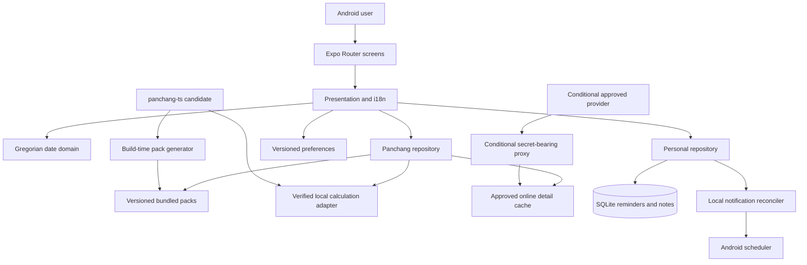
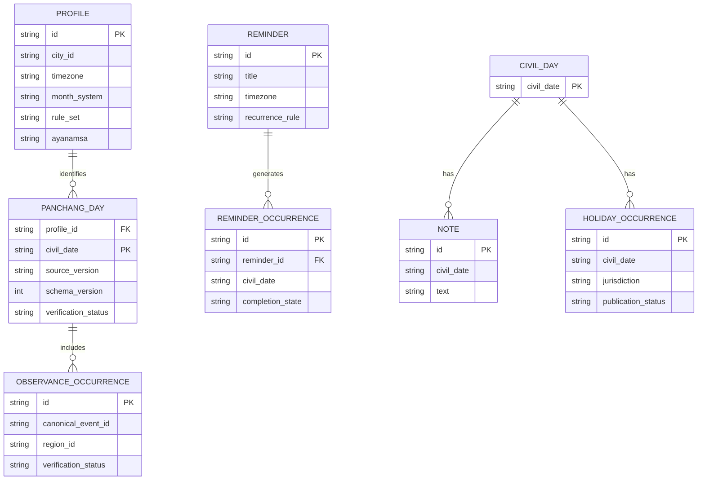
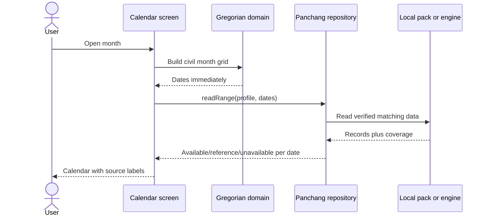
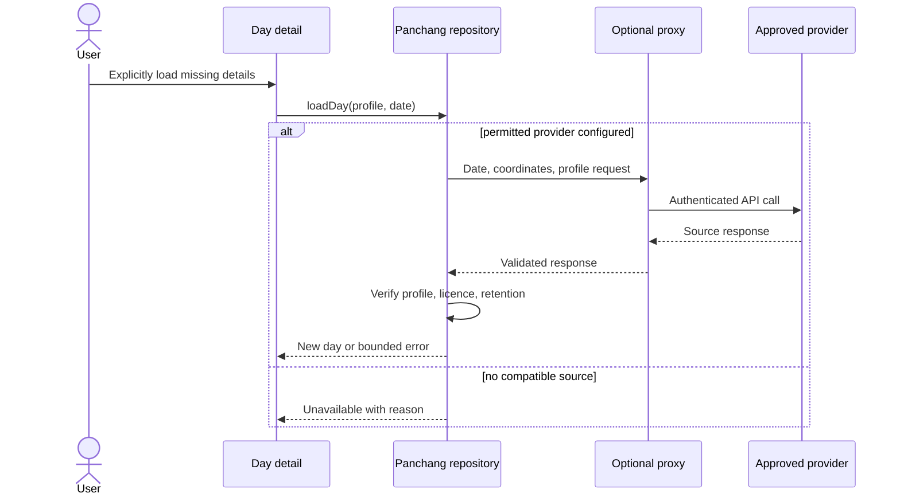

# Architecture — Hindu Calendar

**Date:** 27 September 2026  
**Status:** Implementation contract; data profile and release coverage remain conditional on validation.  
**Authority:** [Master prompt](../HINDU_CALENDAR_CODEX_MASTER_PROMPT.md).

## Product boundaries

Android React Native application with Expo Router, strict TypeScript, four tabs, on-device reminders/notes, and no account or analytics service. Gregorian date navigation is independent of Panchang availability. Hindi and English are launch languages. Exactly one source/profile computes the astronomical and observance fields of a given Panchang record. Government holidays and personal items are separately attributed layers.

The proxy is absent until a free provider passes the rights, capability and quota checks. It receives date/profile coordinates only. Reminder titles, notes, notification state and other personal content never leave the device.

## Domain boundaries

| Module | Owns | Must not do |
|---|---|---|
| `domain/calendar` | Valid civil dates, grids, date arithmetic, selected day | Import Panchang or network modules |
| `domain/panchang` | Profile compatibility, canonical IDs, availability and provenance | Guess unknown fields or combine conflicting conventions |
| `services/panchang` | Source selection and explicit loading | Fetch on swipes or silently use another city |
| `db/repositories` | Persistent personal records, cache metadata and migrations | Put personal records in bundled assets |
| `services/notifications` | Schedule/reconcile occurrence IDs | Own recurrence truth; that stays in the domain |
| `features/*` | Screen actions and view models | Parse provider payloads directly |
| `shared` | Pure validated contracts across generator/client/proxy | Import server credentials into mobile code |

Use Expo SDK 57 compatible package versions; official SDK table currently maps SDK 57 to React Native 0.86, React 19.2.3, minimum Node 22.13.x and Android target 36 ([Expo SDK reference](https://docs.expo.dev/versions/latest/)). Pin exact versions in the lockfile during scaffolding and run Expo Doctor. These facts require rechecking at install and release.

## Read path and source precedence

1. Validate civil date, selected city and semantic profile.
2. Query a verified, matching local record: newest compatible correction from bundle or permitted cache.
3. If no local record, invoke a verified local engine for that selected city/profile when that computation path has passed native and accuracy checks. Save under the same provenance contract.
4. If the selected city has no verified calculation, offer a **clearly labelled reference-city** record. Reference timings never appear as local timings.
5. Only an explicit user action may call an approved remote adapter. Missing data stays unavailable when no approved source can answer.

The first bundle target remains 1,461 valid days for 2026–2029 per approved reference profile. On-device computation for other cities can extend coverage without pretending those cities were bundled. The preferred initial engine candidate is `panchang-ts` 5.4.0, subject to independent accuracy and native validation; no city or month convention is final until the comparison report is written ([candidate documentation](https://github.com/ishankgupta95/panchang/blob/master/source/ts/README.md)).

## Semantic profile and provenance

`profileId` is a hash or stable string of canonical city ID, coordinates, IANA timezone, month system, observance rule set, ayanamsa and sunrise convention. Engine/provider ID, engine version, generator version and schema version are separate provenance fields. Do not treat provider names as semantic profiles or assume Purnimanta alone defines festival dates. Two records compete only if all profile axes match and validation establishes equivalence.

Store civil dates as validated `YYYY-MM-DD`; store event times as full UTC instants and render in the record's location timezone. The device timezone and reminder timezone are separate. Sunrise-based days can intersect two civil dates; retain every limb interval. Missing moonrise has a distinct reason from provider failure.

## Persistence model

Bundled month packs are immutable assets with a checksummed manifest and per-record provenance. SQLite owns user reminders, occurrence completion, notes, versioned preferences if needed, permitted downloaded cache and import metadata. Do not open or parse four years of JSON at launch. Pack month files or a read-only SQLite asset can be chosen after release-mode measurement. Cache clearing only removes downloaded source data.

This is a logical model; bundled Panchang assets need not be duplicated in SQLite. Index reminders by next occurrence/date and cache by `(profile, civil_date, detail_level, source_version)`. Use additive, versioned migrations and a migration test from each supported schema version.

## Critical flows

## Architecture decisions and gates

- **ADR-001**: Prefer a vetted local Panchang engine for the free offline target; see [decision record](./ADR-001-PANCHANG-SOURCE.md).
- Use local SQLite for personal data and versioned source data contracts. A backend database would add cost and privacy surface without serving any required feature.
- Native notifications are scheduled from persisted reminder occurrences and reconciled on app resume/startup. OS permission or scheduling failure cannot delete the reminder.
- Mobile never embeds provider secrets. Add a proxy only when a compatible remote feature is real and authorized.

**Data gate:** no production pack until rights, generated 1,461-day integrity, independent source comparison and observance review pass. **Native gate:** no delivery claim until Android APK/AAB and notification/backup/accessibility evidence exist. Source and convention selection remains provisional while comparison evidence is pending.
